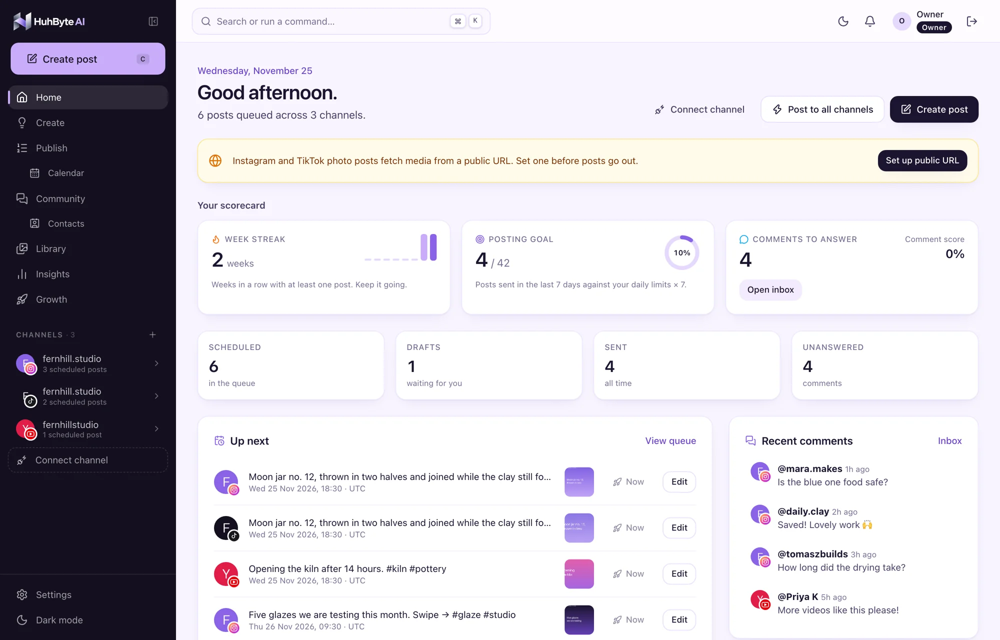
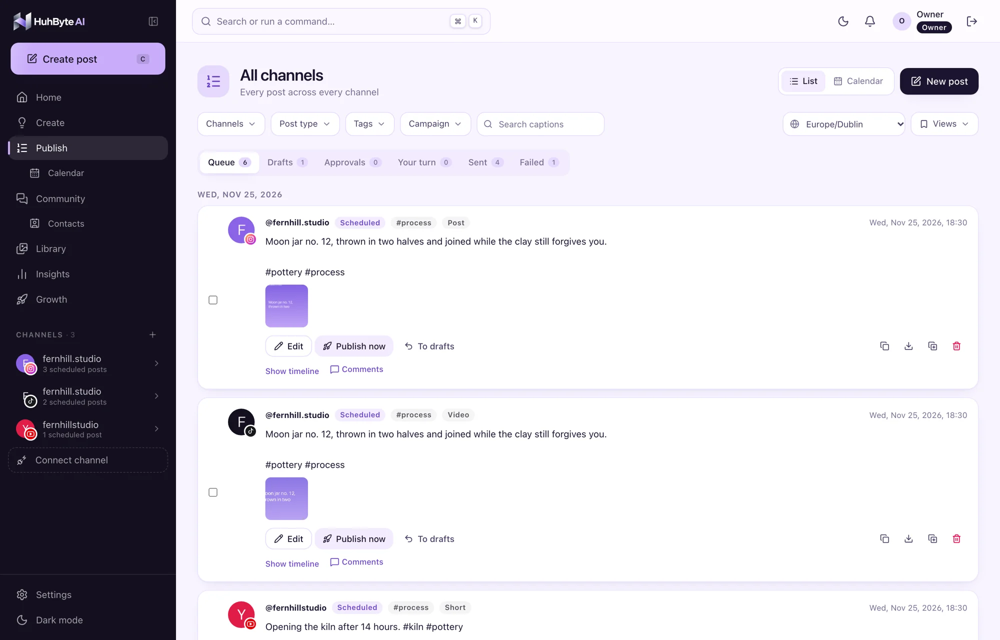
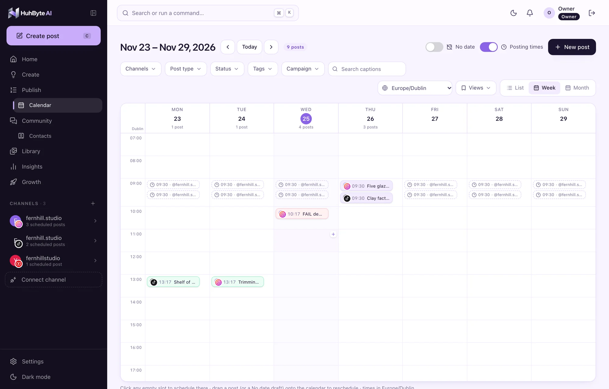
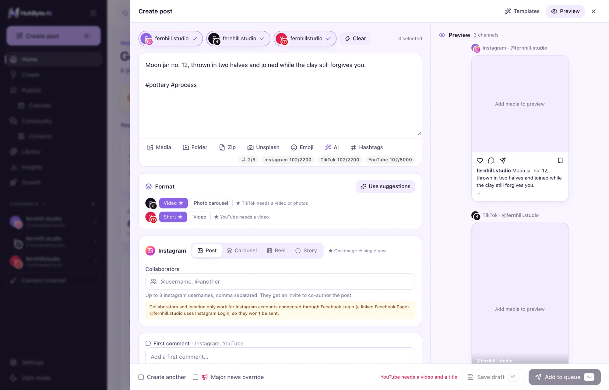
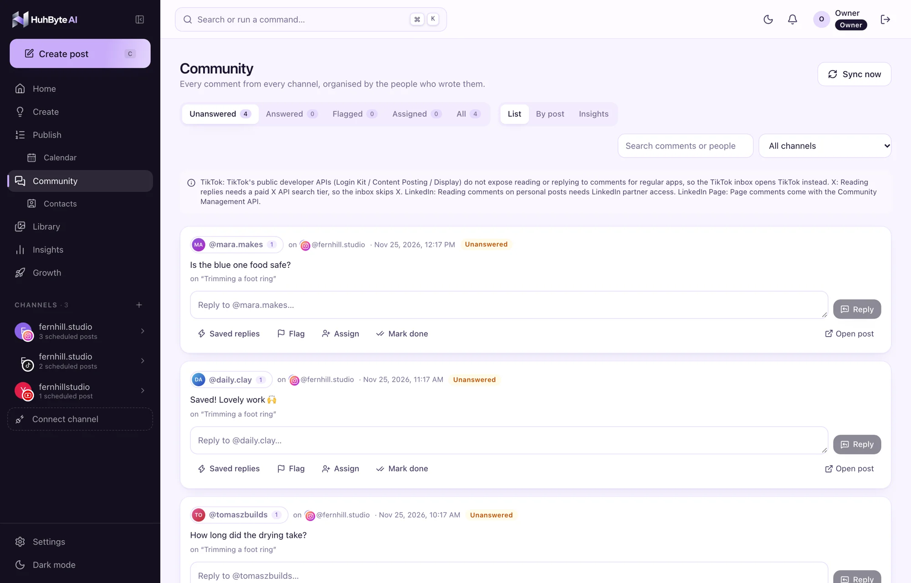
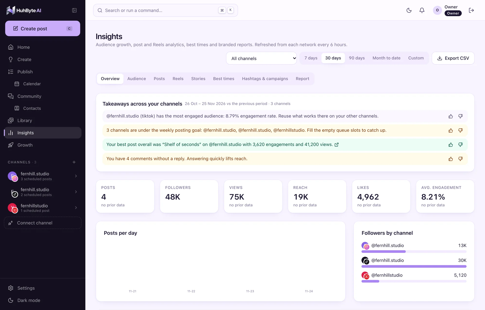
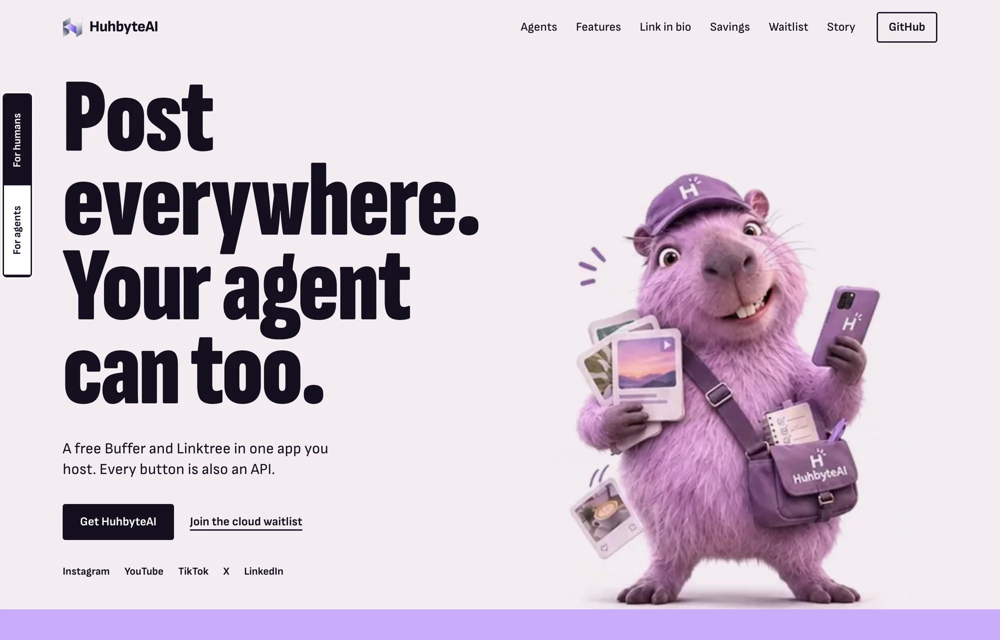
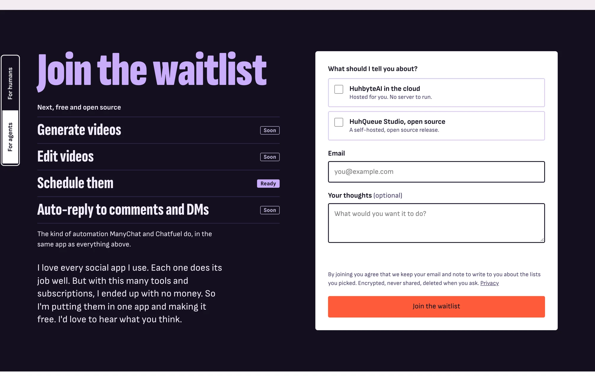

# HuhQueue

**A free, self-hosted social media scheduler (Buffer-style) for Instagram, YouTube, X, TikTok and LinkedIn, built AI-native.**
Write once, schedule everywhere, answer comments, and read your insights from one small Python app with a React UI.
Everything the UI does is also available to agents through a REST API (OpenAPI), an MCP server, a CLI and `/llms.txt`.

No paid tiers, no feature gates, no limits beyond the networks' own. MIT licensed.

Runs on your own machine or any server. It does not need any hosted service, account or domain of ours: your
data (SQLite + media) stays in one folder or Docker volume, and you connect networks with your own developer apps.



| | |
|---|---|
|  **Queue** |  **Calendar** |
|  **Composer** |  **Community inbox** |
|  **Insights** |  **Optional landing page** |

Contents: [Quick start](#quick-start) · [Exposure window](#before-you-put-it-on-the-internet-the-exposure-window) ·
[Connect networks](#connect-your-networks) · [Host it](#host-it-vps-home-server-flyio-railway-render) ·
[Waitlist](#where-is-the-waitlist) · [Features](#features) · [Agents and development](#agents-cli-and-development)

## Quick start

One command, either way:

```bash
git clone https://github.com/dataanalystram/Openbuffer && cd Openbuffer && docker compose up -d --build
```

```bash
git clone https://github.com/dataanalystram/Openbuffer && cd Openbuffer && make run
```

`make run` needs Python 3.10+ (no Node: the built UI is committed). It creates `.venv`, installs, copies `.env.example`
to `.env` and starts the app. No make? `python3 -m venv .venv && . .venv/bin/activate && pip install -e . && huhqueue serve`

Open **http://localhost:8787** and choose a password (that first account is the Owner). Data lives in `./data`
(or the `huhqueue-data` Docker volume); the encryption key for stored tokens is generated there on first run, so back
up that folder or volume.

Try it with no accounts: `make demo` adds a fake "Demo network" with sample posts.

## Before you put it on the internet: the exposure window

> **Set `HUHQ_ADMIN_PASSWORD` before anyone else can reach the server.** A brand-new install has no password. Until one
> exists, the *choose a password* page is open, and **whoever opens it first becomes the Owner**.

- On your own machine this doesn't matter: both `make run` and `docker compose up` listen on `127.0.0.1` only.
- On a server, put `HUHQ_ADMIN_PASSWORD=<a long random password>` in `.env` (or the platform's env) **before the first
  start**. The password then exists from the first second and the setup page is closed.
- Only after that, publish it: put https in front (Caddy, nginx, Cloudflare Tunnel) and set `HUHQ_COOKIE_SECURE=1`.
  `HUHQ_BIND=0.0.0.0` publishes the Docker port directly; only use it behind a firewall or an https proxy.
- A platform that gives the app a public URL by itself (Fly, Railway, Render) is public as soon as it starts, so the
  variable has to be set before the first deploy.
- Started without it on a public address? Stop the server, set the variable and start again with a fresh data folder
  if you don't recognise the Owner account.
- Turn on 2FA (**Settings → Security**). The login page is public on a public server.

## Connect your networks

Each network signs in through **your own developer app** (free). Create it, paste its ID and secret in
**Settings → App keys** (or in `.env`), then click **Connect** on the Channels page. The exact redirect URI to
register is shown next to each key form: it is `<the URL you opened HuhQueue on>/oauth/<network>/callback`.

| Network | Get keys at | Redirect URI on your machine | Notes |
|---|---|---|---|
| YouTube | [Google Cloud console](https://console.cloud.google.com/apis/credentials) (OAuth client, *Web application*) | `http://localhost:8787/oauth/youtube/callback` | Uploads stay private until Google verifies your project (`YOUTUBE_VERIFIED=1`). |
| X | [developer.x.com](https://developer.x.com/en/portal/dashboard) (OAuth 2.0, *Web App*) | `http://127.0.0.1:8787/oauth/x/callback` (open HuhQueue on 127.0.0.1) | X rejects `localhost` callbacks. |
| LinkedIn | [developer.linkedin.com](https://developer.linkedin.com/) | `http://localhost:8787/oauth/linkedin/callback` | Company pages need a second app (`LINKEDIN_PAGES_ENABLED=1`). |
| Instagram | [developers.facebook.com](https://developers.facebook.com/apps/) (Instagram API with Instagram Login) | needs https: `https://<public-url>/oauth/instagram/callback` | Instagram also downloads your media from that public URL. |
| TikTok | [developers.tiktok.com](https://developers.tiktok.com/) (Login Kit + Content Posting API) | needs https: `https://<public-url>/oauth/tiktok/callback` | Posts are private (`SELF_ONLY`) until TikTok audits your app. |

**Instagram and TikTok need a public https URL**, even on a laptop. Easiest: install
[cloudflared](https://developers.cloudflare.com/cloudflare-one/connections/connect-networks/downloads/) or
[ngrok](https://ngrok.com/download) and click **Settings → Start tunnel** (not available inside the Docker image; there,
run `cloudflared tunnel --url http://localhost:8787` on the host and open HuhQueue on the printed https URL).
A cloudflared quick-tunnel URL changes on every start; ngrok's free static domain or your own domain (below) does not,
so you register the callback once. One developer app can hold both the localhost and the https callback.

Numbered, per-network steps: [docs/CONNECT_INTEGRATIONS.md](docs/CONNECT_INTEGRATIONS.md). Compliance callbacks and
details: [SETUP.md](SETUP.md).

## Host it (VPS, home server, Fly.io, Railway, Render)

Scheduled posts only go out while the app runs, so use an always-on host with a **persistent volume** at `/data`.

1. Run the Docker image (`docker compose up -d --build` on a VPS, or point Fly/Railway/Render at this repo's
   `Dockerfile`, mount a volume at `/data`, and expose port **8787**).
2. Put https in front of port 8787 (Caddy, nginx, Cloudflare Tunnel, or the platform's own https).
3. Set in `.env` / the platform's env: `HUHQ_PUBLIC_BASE_URL=https://your.domain`, `HUHQ_COOKIE_SECURE=1`, and
   `HUHQ_ADMIN_PASSWORD=<8+ chars>` (see [the exposure window](#before-you-put-it-on-the-internet-the-exposure-window);
   this must be set before the first start).
   The one public port answers the UI, API, OAuth callbacks and media links.
4. Register `https://your.domain/oauth/<network>/callback` in each developer app.

Every setting is an environment variable listed in [.env.example](.env.example). Run only one instance per data
volume (SQLite, one worker).

## Where is the waitlist?

The repo includes a public landing page with a waitlist, used by the site that hosts HuhbyteAI. **It is off by default**:
on your install `/welcome` and `/waitlist` answer 404 and nothing is collected unless you set `HUHQ_LANDING=1`.

| What | Where |
|---|---|
| The page and the form | `/welcome`, form at `/welcome#waitlist` (source: [huhqueue/static/landing](huhqueue/static/landing)) |
| Backend | `POST /waitlist` ([waitlist_api.py](huhqueue/api/waitlist_api.py), [waitlist.py](huhqueue/services/waitlist.py)) |
| Storage | table `waitlist_entries` in the install's own SQLite database; signups are never in this repo |
| Reading signups | owner or admin only: open `/api/waitlist?format=csv` while signed in, or `huhqueue run waitlist.list` |



Personal data: emails and notes are **encrypted at rest**, never logged, and readable by the owner and admins only (no
public endpoint returns them). Input is validated and capped, with a honeypot, per-IP and total rate limits, one row per
email, and no IP addresses stored. The form has a consent line and links to `/privacy`. Details:
[docs/LANDING.md](docs/LANDING.md).

## Teams

One install is one workspace. The Owner invites teammates from **Settings → Team** with a role (admin, editor,
contributor, client, viewer) and optional per-channel access; contributors' posts go to approval. Invites work as
links; add SMTP settings in `.env` to email them. Optional TOTP 2FA per user.

## Agents, CLI and development

- Agents: `huhqueue token --name agent --scopes read,write` mints a token; `huhqueue mcp` is an MCP server
  (env `HUHQ_URL` + `HUHQ_API_TOKEN`); `huhqueue run <action>`; guides at `/agents` and `/llms.txt`.
- Tests: `make test` (backend). Browser tests: `CHROMIUM_PATH=/path/to/chromium pytest tests/e2e/test_ui.py`.
- UI: edit `web/src`, then `make web` (rebuilds `huhqueue/static/app`, which is committed).

## Features

**Publishing**
- Composer with preview-first side panel, multi-channel chips, per-channel captions, Instagram Post / Reel / Story /
  carousel, collaborators, first comment, AI-disclosure, templates, hashtag groups, alt text, format suggestions.
- Queue with posting slots, prioritise, drag-to-reorder, per-channel daily limits with a major-news override,
  "same story never twice on one channel" guard, retries, approvals for agent tokens.
- Calendar (list / week / month), undated-drafts tray, timezone-aware drag, shared filter bar (channels, type, status,
  tags, campaign, search, timezone) with saved views.
- Video end card ("Follow @handle") added by ffmpeg, PNG/WebP→JPEG for Instagram, 50/24h IG publish cap respected.

**Engagement and insights**
- Community inbox: Unanswered / Answered / Flagged / Assigned, commenter profiles with history across posts, saved
  replies, assign, flag, done.
- Insights: KPIs, posts by day, top posts, CSV export of every post in the range; per-channel account insights and
  history grid.

**Agents and automation**
- One action registry that generates the REST actions endpoint, MCP tools, ⌘K entries, the CLI and `/llms.txt`.
- Bring your own AI model (Settings › AI model): NVIDIA NIM, Google Gemini, Groq, OpenRouter, Ollama, OpenAI, Anthropic
  or any OpenAI-compatible URL (LM Studio, vLLM). Key stored encrypted, test connection, model picker, thinking models
  supported. It powers the composer AI writer, post ideas, alt text, comment themes, reply suggestions and the command bar.
  Headless setup with `HUHQ_AI_*` in `.env` or `huhqueue ai set`; agents get `ai_status` / `ai_write` but never the key.
- Natural-language command bar ("schedule the launch reel for Friday 7pm on Instagram") with a confirm step
  for public or destructive actions, and a deterministic fallback parser when no AI model is set.
- Scoped API tokens (scopes, tool allow-list, rate limit, require-approval), audit log of every token and UI action.

## Connectors

Each network is one file in `huhqueue/connectors/` that implements the contract in `base.py`. Third-party packages can
register more through the `huhqueue.connectors` entry-point group. Facebook Pages, Threads and Bluesky are not built yet.

## Docs

- [docs/CONNECT_INTEGRATIONS.md](docs/CONNECT_INTEGRATIONS.md): connect LinkedIn (profile + pages), Instagram, YouTube, X, TikTok and import a Buffer CSV, step by step.
- [SETUP.md](SETUP.md): developer apps, redirect URIs, Meta compliance callbacks, hosting.
- [docs/INSTAGRAM_WEBHOOKS.md](docs/INSTAGRAM_WEBHOOKS.md): instant comment sync from Instagram.
- [docs/LANDING.md](docs/LANDING.md): the optional landing page and its waitlist.
- [.env.example](.env.example): every setting.

## Open-source credits

HuhQueue's UI is built on these projects. Thank you to their authors.

| Project | Used for | Licence |
|---|---|---|
| [React](https://react.dev) | UI library | MIT |
| [Vite](https://vite.dev) | Build tool | MIT |
| [Tailwind CSS](https://tailwindcss.com) | Styling | MIT |
| [Motion](https://motion.dev) (formerly Framer Motion) | Animations | MIT |
| [lucide](https://lucide.dev) (`lucide-react`) | Icons | ISC |
| [clsx](https://github.com/lukeed/clsx) | Class names | MIT |
| [tailwind-merge](https://github.com/dcastil/tailwind-merge) | Class merging | MIT |
| [shadcn/ui](https://ui.shadcn.com) conventions | Theme tokens and component patterns (no code copied as a dependency) | MIT |
| [React Bits](https://reactbits.dev)-inspired components | e.g. `CircularText`; written as our own code, inspired by React Bits' ideas | own code (React Bits is MIT + Commons Clause) |

Backend: [FastAPI](https://fastapi.tiangolo.com) (MIT), [SQLAlchemy](https://www.sqlalchemy.org) (MIT),
[httpx](https://www.python-httpx.org) (BSD-3), [Pillow](https://python-pillow.org) (MIT-CMU),
[cryptography](https://cryptography.io) (Apache-2.0 / BSD), [Uvicorn](https://www.uvicorn.org) (BSD-3),
[Playwright](https://playwright.dev) for tests (Apache-2.0).

## Licence

MIT, see [LICENSE](LICENSE).
